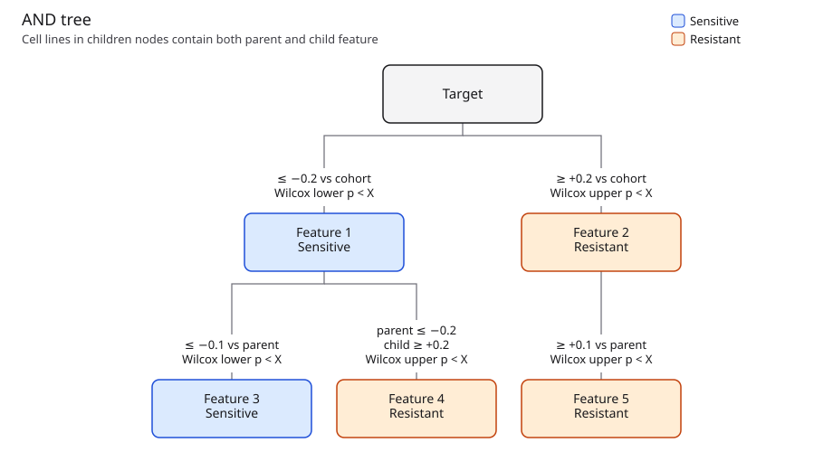
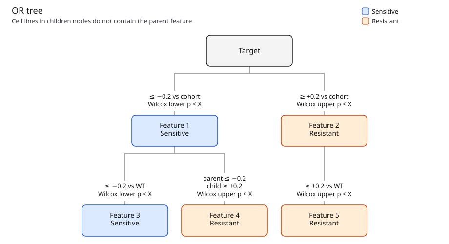
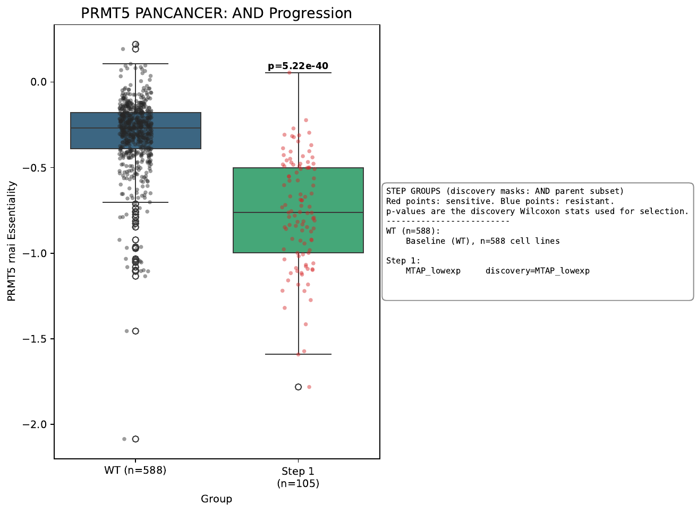

# kopredict

kopredict finds genomic features linked to CRISPR or RNAi sensitivity. The search is a Wilcoxon test, Jaccard grouping, and a feature tree. `kopredict-download` and `kopredict-prepare` rebuild the inputs from public files.

```bash
pip install -e .
```

Python 3.9 or newer. Processed files go in `data/` (override with `KOPREDICT_DATA_DIR`). Raw downloads go in `data/raw/`. Cell-line ids are DepMap `ModelID` values such as `ACH-000001`, in a column named `cellline`.

## 1) Download data

```bash
kopredict-download
kopredict-download --depmap-release 25Q3
```

- `--depmap-release` is the DepMap quarter (default `26Q1`). Every `{depmap}` filename must exist in that release.
- [`metadata/20260920_DepMap_available_downloads.csv`](metadata/20260920_DepMap_available_downloads.csv) is the catalog, including signed URLs. Those URLs expire. Replace the file from [depmap.org/portal/api/download/files](https://depmap.org/portal/api/download/files) when a link fails. Three older files have locally computed checksums (`D2_combined_gene_dep_scores.csv`, `sanger-dose-response.csv`, `sanger-viability.csv`). A blank `md5_hash` stops prepare.
- [`metadata/default_depmap_files_to_download_and_process.csv`](metadata/default_depmap_files_to_download_and_process.csv) chooses which catalog rows to fetch. `{depmap}` follows `--depmap-release`. Other rows, such as DEMETER2, GDSC, and proteomics, keep the release written in the CSV.
- [`metadata/additional_datasets_to_download.csv`](metadata/additional_datasets_to_download.csv) lists files outside the catalog. If Cell.com blocks the Petljak et al. signature workbook, save [mmc3.xlsx](https://www.cell.com/cms/10.1016/j.cell.2019.02.012/attachment/4e70a2ab-6758-47e5-a843-802a5474bc82/mmc3.xlsx) ([paper](https://www.cell.com/cell/fulltext/S0092-8674(19)30161-8)) as `data/raw/mmc3.xlsx`. Prepare reads the sheet `COSMIC CellLines Signatures`.
- GDSC dose-response and viability are downloaded only. Drug-response search is not implemented yet.

## 2) Prepare data

```bash
kopredict-prepare
kopredict-prepare --depmap-release 25Q3
```

Use the same `--depmap-release` as the download. A missing file, a blank `md5_hash`, or a bad checksum stops the command. Non-cancer models are left out of the feature matrix.

| File | Contents |
| --- | --- |
| `Model_and_OmicsSignatures.parquet.gz` | Model metadata, signatures, HRD, SBS |
| `OmicsFull_processed.parquet.gz` | Long gene table for the `group_options` filter |
| `Proteomics_processed.parquet.gz` | Sanger, Gygi, and RPPA z-scores (UniProt ids) |
| `CRISPRGeneEffect_processed.parquet.gz` | CRISPR gene effect |
| `D2_combined_gene_dep_scores_processed.parquet.gz` | DEMETER2 RNAi scores |
| `final_depmap_features_26Q1.parquet.gz` | Binary features (rows) by cell line (columns) |

`has_hessdriver`, `has_oncogenehighimpact`, and `has_tumorsuppressorhighimpact` are not rebuilt.

### Features

Each feature is 1, 0, or missing for a cancer cell line. Gene rows use protein-coding symbols from `Gene.csv`. Proteomics keep the UniProt accession. Constant rows are dropped. Identical rows are merged and their names joined with `:`. Expression and protein z-scores use a cutoff of 1.64.

| Feature | Call |
| --- | --- |
| `{gene}_amp` / `{gene}_homdel` | WGS copy number when the model has any WGS value, otherwise WES. Amp is a ratio of at least 2. Homdel is below 0.1. |
| `{gene}_mutdamaging` / `{gene}_muthotspot` | Count greater than 0. |
| `{gene}_likelylof` | `LikelyLoF`, or nonsense, frameshift, splice site, or nonstop. |
| `FUSION_{left}_{right}` | Gene pair in `OmicsFusionFiltered.csv`. |
| `{gene}_highexp` / `{gene}_lowexp` | Expression z above 1.64 or below −1.64. |
| `{id}_high…` / `{id}_low…` | Same z cutoff. Suffixes are `sangerprot`, `depmapprot`, and `rppa`. |
| `{gene}_ko` | Homdel or likely loss of function. |
| `{gene}_altered` | Damaging, hotspot, amp, homdel, fusion, or ko. |
| `{signature}_True` | SBS exposure greater than 0 (`mmc3.xlsx`). |
| `hrdscorehigh_1` | HRD at least 42 (`hrdsum_summary`, otherwise `hrdsum_broad`). |
| One-hot model fields | MSI, ploidy, aneuploidy, CIN, LOH, WGD, Oncotree, and related annotations. |

The search tests these rows against the target gene's continuous CRISPR or RNAi score. Those scores are not turned into features. By default, names containing `lowexp`, `highexp`, `depmapprot`, `sangerprot`, or `rppa` are dropped. Set `keep_expression_features` or `keep_proteiomic_features` to keep them (`rppa` follows the protein flag).

## 3) Run

```bash
kopredict
kopredict path/to/run.yaml
kopredict --help
```

Settings are in [`metadata/kopredict_default.yaml`](metadata/kopredict_default.yaml): target `PRMT5`, dataset `rnai`, cohorts in [`metadata/oncotree_cohorts_solid.csv`](metadata/oncotree_cohorts_solid.csv). Copy that file to change a run. Omitted keys are filled from the default. Set `cancer_types` or `cohort_csv`, not both.

- One cohort: set `oncotree_column` and `cancer_types` (one value or a list). Allowed values are in [`metadata/oncotree.yaml`](metadata/oncotree.yaml). `PANCANCER` and `SOLID` do not use `oncotree_column`.
- Several cohorts: set `cancer_types` to null and `cohort_csv` to a CSV. A path such as `metadata/oncotree_cohorts_solid.csv` is resolved from the source directory. Required columns are `oncotree_column` and `name`. `output_name`, when present, is the result-folder name. A `name` may list several values separated by semicolons. Quote values that contain a comma.
- Output goes to `data/output/{target}/{dataset}/` unless `output_dir` is set. Each cohort gets an AND boxplot PDF, an OR boxplot PDF, and rows in one summary CSV. `Logic_type` is `AND` or `OR`. `sens_res` is `sensitive` or `resistant`. A cohort with no marker, or too few essential lines, is a `FLAG` row and has no boxplot.

### Examples

From the repository root, after prepare, with matrices already in `data/`:

```bash
kopredict example/prmt5_rnai.yaml
kopredict example/prmt5_rnai_expr_prot.yaml
```

Both match the default search. `n_jobs` is 16 so the shuffles run together. `example/prmt5_rnai.yaml` leaves expression and proteomics off and writes to `example/prmt5_rnai/`. `example/prmt5_rnai_expr_prot.yaml` keeps them and writes to `example/prmt5_rnai_expr_prot/`.

## How a feature is chosen

### Inverse features

- The forward test selects the `1`s and keeps the original name.
- The inverse test selects the `0`s, swaps `0` and `1` (missing stays missing), and adds `_inverse` to every `;` and `:` piece. `MTAP_homdel:MTAP_ko` becomes `MTAP_homdel_inverse:MTAP_ko_inverse`.
- Sensitivity uses the lower tail. Resistance uses the upper tail.
- When both directions pass, the search keeps the selected group with fewer cell lines. A tie keeps the forward name. The other direction is excluded for the rest of the branch.

### P-value cutoffs

- Each step is a Wilcoxon rank-sum test on features that pass the effect-size filter and have at least `min_group_count` lines on each side (default 3). q-values are Benjamini–Hochberg.
- Labels are shuffled `n_permutations` times (default 50). The cutoff is the mean of the lowest `ceil(n * null_percentile / 100)` null minima (default percentile 5, so the mean of the 3 smallest).
- A feature is kept when its p and q are both below those cutoffs.
- The root uses the full cohort. Each later subset is shuffled again, separately for sensitivity, resistance, AND, and OR. A subset reuses a cutoff when the cell-line count is within 5% and the direction, comparison, and threshold match.

### Grouping

- Features that pass are ordered by ascending Wilcoxon p. The first is a seed. A later feature joins the first seed with Jaccard similarity of at least `jaccard_threshold` (default 0.8). Otherwise it starts a group.
- Jaccard uses cell lines called `1`. Missing is not a `1`.
- Sensitivity and resistance are grouped separately. If a feature and its inverse both passed, only the smaller selected group is grouped.

### Adding a feature

`X` in the diagrams is that step's permutation p-value cutoff.

- A sensitive root is at or below `min_effect_size` versus the cohort (default −0.2). A resistant root is at or above `resistance_min_effect_size` (default +0.2).
- AND children are tested in cell lines that carry the parent. Same-direction children use `child_min_effect_size` / `child_resistance_min_effect_size` (default ±0.1 versus the parent).
- A resistant child under a sensitive parent also needs the parent at or below `strong_min_effect_size` (default −0.2). A resistant parent continues only with another resistant child.
- OR children are tested in cell lines that lack the parent. Same-direction OR children use ±0.2 versus WT. A direction switch uses ±0.2 versus the parent.
- Siblings expand best first. A sibling cannot see itself or an earlier sibling.



Cell lines in children nodes contain both parent and child feature.



Cell lines in children nodes do not contain the parent feature.

## PRMT5 RNAi examples

Bands are HGNC locations from DepMap `Gene.csv`. MTAP, CDKN2A, and CDKN2B are at 9p21.3. PRMT5 is at 14q11.2. Both runs use 693 solid-cancer lines with a PRMT5 RNAi score. A more negative score is more sensitive.



- `MTAP_lowexp` is the top PANCANCER marker when expression is on: 105 lines, median −0.76 versus −0.27, p = 5.22e-40. `MTAP_homdel` is 141 lines, median −0.71 versus −0.27, p = 1.2e-36. Of the 105 low-expression lines, 102 are also deleted. The 39 deleted lines that still express MTAP have median −0.39. Low Gygi protein (`Q13126`, MTAP) agrees (25 lines, median −0.77, p = 1.84e-9). The Sanger low-protein call does not.
- The genomic summary's top row groups `MTAP_homdel`, `MTAP_ko`, and `MTAP_altered`. Its p-value (1.2e-36) and count (141) are the deletion. The median on that row (−0.60) is the combined call (163 lines).
- `MTAP_ko` matches the deletion in 141 of 143 lines. The other two are likely loss-of-function, wild type for CDKN2A, and score −0.11 and −0.22. Inside the altered group, lines without a CDKN2A deletion (12 lines, median −0.23 versus −0.67), lines without a CDKN2B call (31 lines, median −0.26 versus −0.72), and a CDKN2A–MTAP fusion (17 lines, median −0.17) are resistant. Those calls do not behave like MTAP loss.
- Other strong PANCANCER hits are the same 9p21 deletion: CDKN2B, the interferon cluster, DMRTA1, KLHL9, FOCAD, ELAVL2, and MLLT3 at 9p21.3, plus TUSC1, CAAP1, LINGO2 (9p21.2), and SLC24A2 (9p22.1). NSCLC, LUAD, glioma, and breast follow that region.
- Off that region, `CRIP2` low expression (14q32.33) still separates lines that are not MTAP-deleted (15 lines, p = 2.89e-6). `DDX56` alteration (7p13) is weaker after those lines are removed (14 lines, p = 2.66e-4). Colorectal models have one hit, `OR10A2` high expression at 11p15.4 (7 lines, p = 1.01e-4).

| Run | Summary | Plot |
| --- | --- | --- |
| Genomic | [summary CSV](example/prmt5_rnai/PRMT5/rnai/261012_PRMT5_rnai_cohort_prediction_summary.csv) | [PANCANCER AND PDF](example/prmt5_rnai/PRMT5/rnai/PANCANCER/2026-10-12_PRMT5_rnai_AND_PANCANCER_boxplots.pdf) |
| Expression and proteomics | [summary CSV](example/prmt5_rnai_expr_prot/PRMT5/rnai/261012_PRMT5_rnai_cohort_prediction_summary.csv) | [PANCANCER AND PDF](example/prmt5_rnai_expr_prot/PRMT5/rnai/PANCANCER/2026-10-12_PRMT5_rnai_AND_PANCANCER_boxplots.pdf) |
| Colorectal, expression on | same expression summary | [COAD AND PDF](example/prmt5_rnai_expr_prot/PRMT5/rnai/COAD/2026-10-12_PRMT5_rnai_AND_COAD_boxplots.pdf) |

## Docker

The image does not contain DepMap files. The working directory is `/opt/kopredict`. Mount the host `data/` directory at `./data`:

```bash
docker build -t kopredict .
docker run --rm --entrypoint kopredict-download -v "$PWD/data:/opt/kopredict/data" kopredict --depmap-release 26Q1
docker run --rm --entrypoint kopredict-prepare -v "$PWD/data:/opt/kopredict/data" kopredict
docker run --rm -v "$PWD/data:/opt/kopredict/data" kopredict
```

## Background cell lines

`group_options` limits the cohort to cell lines in `data/OmicsFull_processed.parquet.gz`. Several rules are separated by semicolons and combined with AND. A cell line missing the column for that gene is dropped.

```text
GENE,omics,COLUMN,greater|less|equal,VALUE,true|false
```

- `omics` is required. The filter reads this file only.
- `greater`, `less`, and `equal` compare the column with `VALUE`.
- `true` recomputes a z-score on that column and compares `VALUE` with the new z-score. `false` uses the stored values. Below 50 cell lines, a `true` rule switches to the 25% quantile of the stored column.

```text
KRAS,omics,muthotspot,greater,0,false
KRAS,omics,tpmlogp1_zscore,greater,2.5,false
TP53,omics,mutdamaging,greater,0,false
```

| Column | Contents |
| --- | --- |
| `cellline` | DepMap `ModelID`. Identifies the row; not a rule column. |
| `gene` | HGNC symbol. Identifies the row; the rule names the gene separately. |
| `cnv` | Copy-number ratio. WGS when the model has any WGS value, otherwise WES. |
| `cnv_call` | `Amp`, `HomDel`, or empty. |
| `mutdamaging` | Damaging-mutation count from `OmicsSomaticMutationsMatrixDamaging.csv`. |
| `muthotspot` | Hotspot-mutation count from `OmicsSomaticMutationsMatrixHotspot.csv`. |
| `tpmlogp1` | Log TPM from `OmicsExpressionTPMLogp1HumanProteinCodingGenes.csv`. |
| `tpmlogp1_zscore` | Per-gene z-score of log TPM, using the population standard deviation. |
| `altered` | 1 when damaging, hotspot, amplification, homozygous deletion, fusion, or knockout is present. |
| `ko` | 1 for a homozygous deletion or a likely loss-of-function call. |
| `crispr` | CRISPR gene-effect score. |
| `rnai` | DEMETER2 RNAi score. |

A rule column must be one of `cnv`, `cnv_call`, `mutdamaging`, `muthotspot`, `tpmlogp1`, `tpmlogp1_zscore`, `altered`, `ko`, `crispr`, or `rnai`.

## Future updates

1. Add PRISM and GDSC as target datasets, alongside CRISPR and RNAi.
2. Accept a user-supplied knockout dataset as the target scores.
3. Score and prioritize sensitive and resistant markers with gene function, pathway membership, TCGA, and other datasets as evidence that a hit is biological.
